# ANN 神经元模拟器 · 修改记录

- **日期**：2026-11-09
- **基线**：git `4ffc9e2`（2021-12-07，提交信息 `finish2`），也就是数据结构课设最后的版本
- **改后的代码**：`E:\Claude code\ann-qt`。原来的 `C:\Users\67495\Documents\ANN` 没动过
- **环境**：Qt 6.1.3 + MinGW 8.1.0 64-bit（MinGW：Minimalist GNU for Windows，Windows 上的 GCC 工具链；GCC：GNU Compiler Collection，GNU 编译器套件）
- **阅读**：同目录的 `修改记录.html` 是这份文档的网页版（带目录，截图可点开看原图），改了本文件后运行 `python docs/build_html.py` 重新生成

---

## 0. 一页看完

| | 修改前 | 修改后 |
|---|---|---|
| 实际复现出的问题 | 17 条（复现程序逐条跑过，见 §5.1） | 全部修好，每条都有对应的自动化测试 |
| 自动化测试 | 没有 | 41 个用例，全部通过 |
| 编译 | `Documents\ANN` 现在的工作区编译失败；git 里的版本有 41 条警告 | 0 警告、0 错误 |
| 什么都不做，空闲 2 秒 | 重绘 3607 次，CPU 时间 1969 ms（一个核跑满） | 重绘 0 次，CPU 时间 0 ms |
| 有跳层连接的网络（§2.2 的例子） | 输出 0.16（错） | 输出 0.224（对） |
| 一次前向计算（70 个神经元、1200 条边） | 2231 ms | 0.077 ms |
| 代码结构 | 同一份数据存两份（界面一份、图一份），3 个几乎一样的神经元类 | 只有一份数据（`Network`），画布只负责显示和交互 |

**你记得的“删除”问题确实存在，而且不止一处**：R1（删神经元删错线）、R2（删除循环漏删）、R3（删过线后，新线的权值不参与计算）、R14（“删除线”和“删除点”共用一个开关）、R15（删线后结果不清零）。

**只有一处会改变计算结果**（R16）：阈值原来是“激活之后再减”，现在改成了“先减再激活”，即 f(x) − θ 改成 f(x − θ)。2026-11-09 已确认保留新公式；原公式的问题和换回去的方法留在 §2.2 备查。

---

## 1. 找到的项目

Qt Creator 最近打开的项目列表里，第一个就是 `Documents\ANN\ANN.pro`。电脑上一共有三份：

| 位置 | 是什么 |
|---|---|
| `C:\Users\67495\Documents\ANN` | Qt Creator 打开的这份，是 git 仓库，HEAD = `4ffc9e2` |
| 桌面 `大学\大三\大三上\数据结构\…课设\ANN` | 交课设时拷的副本，内容和 `4ffc9e2` 一样 |
| 桌面 `大学\ann-master` | 从 Gitee 下载的 `4ffc9e2` 压缩包 |

`Documents\ANN` 里有没提交的改动：`dialog.ui` 在 2022-06-28 被 Qt Creator 的空白对话框模板覆盖，“激活函数”两个单选框和“阈值”输入框都没了。可是 `dialog.cpp` 还在用 `ui->Yuzhi`、`ui->func1`、`ui->func2`，所以这份现在编译会报 3 个错。副本里先按 git HEAD 恢复了 `dialog.*`，再在这个基础上修改。

---

## 2. 问题清单

编号和复现程序、测试用例里的编号一一对应。代码位置都是指原版（`4ffc9e2`）。

### 2.1 删除相关

#### R1　删神经元时删错了线
- **现象**：两个输入神经元 0、1 都连到隐层 2，删掉 0 以后，0 的线还挂在原处，1 的线反而没了。界面上的数据和计算用的数据从此对不上。

  | 删除前 | 删除 0 号之后（原版） | 删除 0 号之后（新版） |
  |---|---|---|
  | 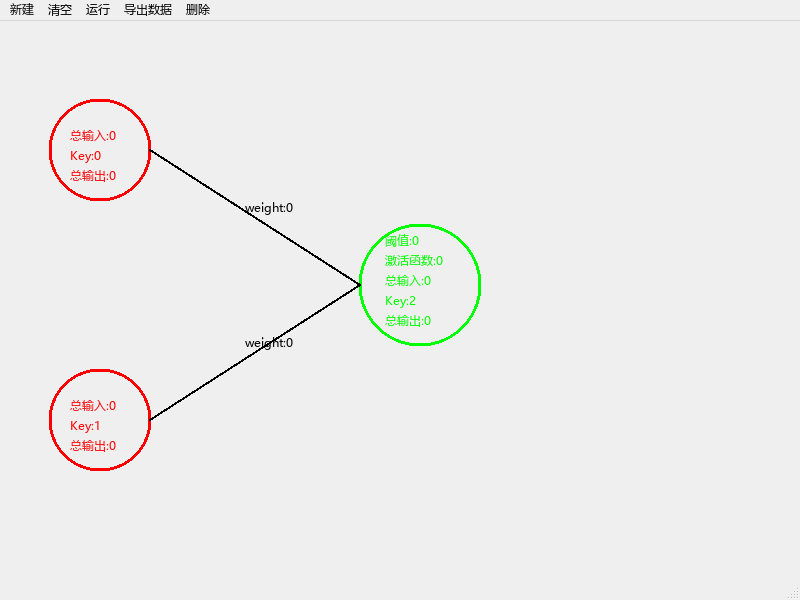 | 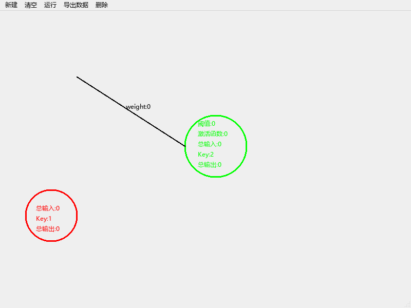 | 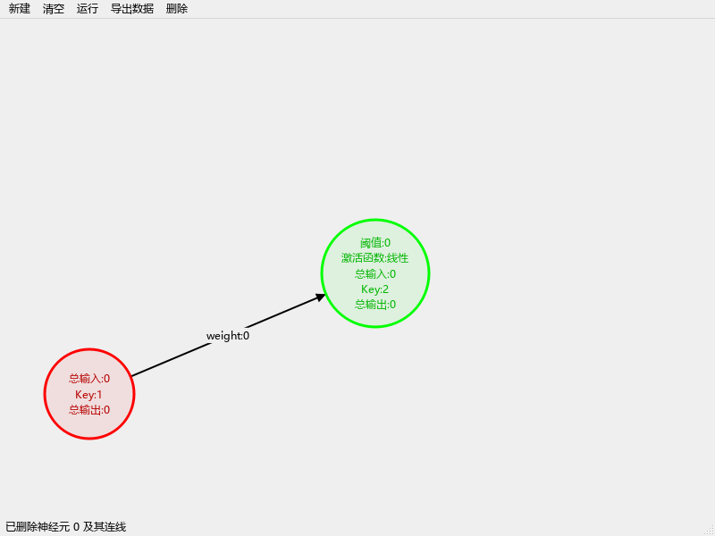 |

- **原因**：`mainwindow.cpp:339-341`（隐层 360-362、输出 381-383 是同样的写法）
  ```cpp
  a.delvertax(Ineure[i].getkey());
  Ineure.erase(Ineure.begin()+i);   // 第 i 个删掉，后面的元素整体往前挪一格
  delInputneure(Ineure[i]);         // 这时的 Ineure[i] 已经是“下一个”神经元了
  ```
  如果删的正好是最后一个，`Ineure[i]` 就越界了，属于 UB（Undefined Behavior，未定义行为）。在 MinGW 上读到的往往还是刚删掉那个元素的旧内存，所以有时候看起来“没问题”，这类 bug 因此很难察觉。
- **修改**：删除统一走 `Network::removeNeuron(id)`：按 id 找到神经元，把它和相连的线在同一个地方一起删掉，erase 之后不再用下标去取元素。

#### R2　删除循环会漏删
- **现象**：隐层神经元有两条出线时，删掉它只删得掉一条。
- **原因**：`mainwindow.cpp:574-579、583-596、601-606`，`adjacency_list.cpp:55-60、76-92` 都是同一种写法：
  ```cpp
  for(int i=0;i<(int)tp.size();i++){
      if(...){ tp.erase(tp.begin()+i); i=0; }   // 设成 0 以后 for 还会执行 i++，下一轮从 1 开始，新的 tp[0] 被跳过
  }
  ```
  另外 `mainwindow.cpp:586、593` 在 erase 之后马上 `qDebug()<<tp[i]…`，也可能越界。
- **修改**：用 erase-remove 惯用法，一遍扫完：
  ```cpp
  m_edges.erase(std::remove_if(m_edges.begin(), m_edges.end(),
                               [id](const Edge &e) { return e.from == id || e.to == id; }),
                m_edges.end());
  ```
  `remove_if` 把要保留的元素挪到前面，返回“新的结尾”；`erase` 再一次截掉后面那段。如果想继续用下标循环，正确写法是 erase 之后 `i--`，或者从后往前遍历。

#### R3　删过线以后，新连的线设了权值也不参与计算
- **现象**：连一条线 → 删掉 → 再连一条 → 设输入 1、权值 2 → 运行，输出是 0，不是 2。线上显示的明明是“weight:2”。

  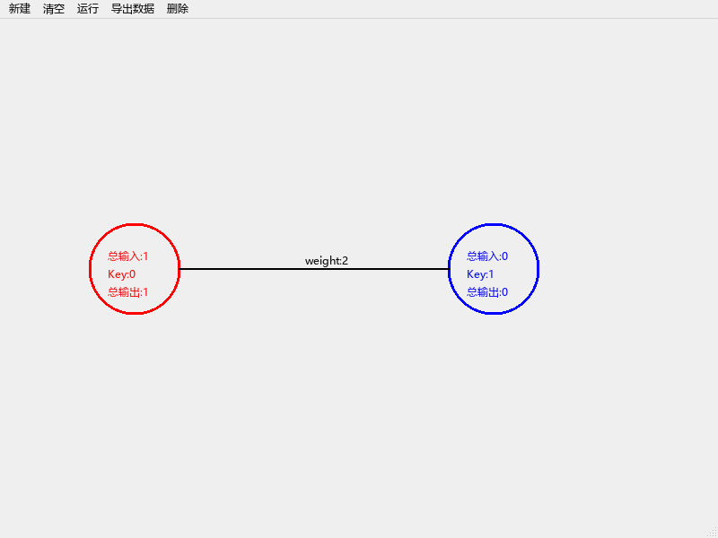

- **原因**：同一条线有两套编号。界面用 `transkey`，只增不减（`mainwindow.cpp:474-477、487-490`）；图里却在 `addEdge` 里改成了当前边数 `m`（`adjacency_list.cpp:22`），删线时 `m--`（第 62 行）。删过一次之后两套编号就错开了：设权值的 `intransport`（319-327 行）按编号去图里找，找不到，权值就没传过去。更糟的是，图里可能出现两条编号相同的边，删一条会连另一条一起删。`delvertax` 删入边时还漏了 `m--`（第 85 行），编号偏得更厉害。
- **修改**：只保留一份数据，边的 id 由 `Network` 统一分配，只增不减、永不复用。不存在第二份数据，也就不存在“两边对不上”。

#### R3b　点“清空”之后，重新搭同一个网络，结果变成 0
- **原因**：清空时（`mainwindow.cpp:65-73`）把 `key` 归零了，`transkey` 却没归零；`clrdesk()` 又把图里的 `m` 归零（`adjacency_list.cpp:254-262`）。于是清空后的第一条线编号就对不上，和 R3 是同一个问题。
- **修改**：`Network::clear()` 把两个计数器一起归零。

#### R14　“删除线”和“删除点”其实是同一个开关
- **现象**：选了“删除线”，点到神经元上，神经元照样被删；点了空白处，删除模式仍然挂着，界面也没有任何提示，下一次想拖神经元时，一点它就被删了。
- **原因**：两个菜单项都只是 `deleteallkind=1`（`mainwindow.cpp:93-104`），而按下鼠标时先检查神经元、后检查线（337、358、379、405 行）。
- **修改**：画布上有三种独立的模式 `Mode { Normal, DeleteNeuron, DeleteEdge }`。进入删除模式时状态栏给提示，鼠标变成十字，悬停在会被删除的对象上时高亮成橙色。点空白处只提示、不退出，删掉一个之后回到普通模式，Esc 或右键随时取消。

  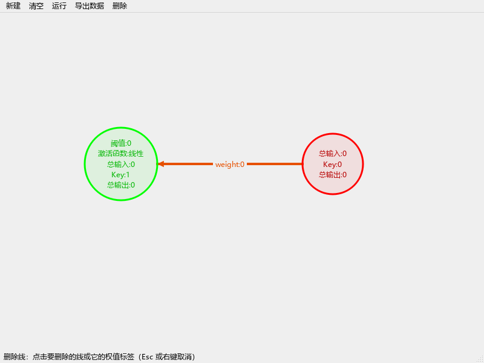

#### R15　删掉线再运行，结果还是上一次的
- **原因**：`TopSort` 只有在处理“某条进来的线”时才会写这个神经元的值（`adjacency_list.cpp:159-168`），没有线进来的神经元保持旧值，`retOutput` 又把旧值抄回界面。
- **修改**：`run()` 开始前先把所有非输入神经元的总输入、总输出清零。

### 2.2 计算相关

#### R4　有“跳层连接”时，拓扑排序算错
- **例子**：0→2、1→3、2→3、3→4，权值都是 0.4，两个输入都是 1。2、3 是隐层（线性，阈值 0），4 是输出。3 同时收到输入层（1）和隐层（2）的线。
  - 正确结果：H2 = 0.4；H3 = 1×0.4 + 0.4×0.4 = 0.56；O4 = 0.56×0.4 = **0.224**
  - 原版：H3 显示 0.56，O4 却是 **0.16** = 0.4×0.4

  | 原版 | 新版 |
  |---|---|
  | 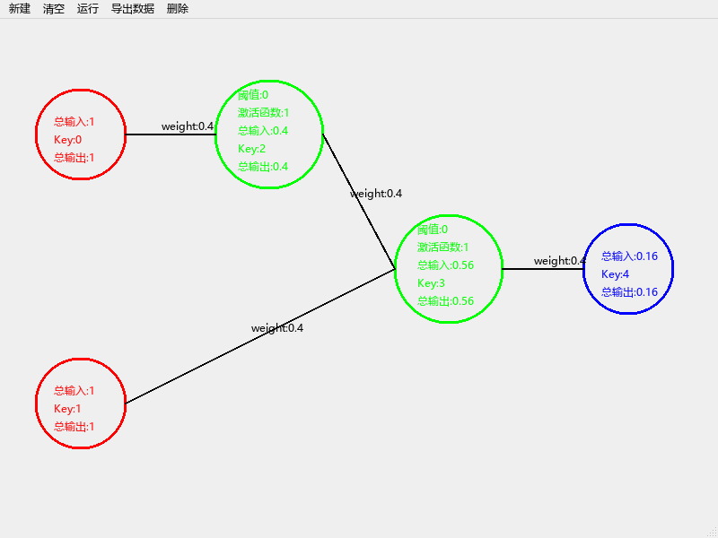 | 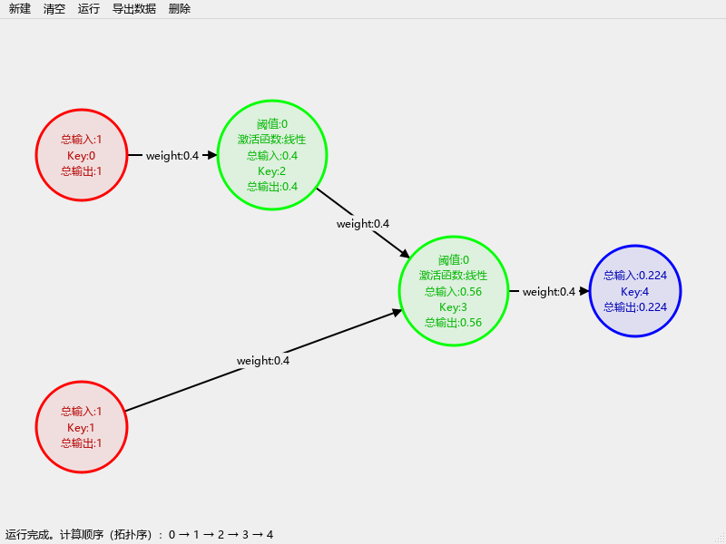 |

- **原因**（`adjacency_list.cpp:99-242`）：
  1. 每处理完一个节点，就把**所有**入度为 0 的节点再压一遍队列（209-220 行），同一个节点会被重复入队；
  2. 每次出队（包括重复的那几次）都会把后继节点的入度减一次（183-192 行），于是入度会**提前**减到 0，甚至减成负数；
  3. 队列里存的是节点的**拷贝**（111、216 行），入队时的“半成品”输出就被冻结在拷贝里了；
  4. 为了防止重复出队时把同一条线的贡献加两遍，第 144 行用完一条线就把它的权值设成 0。这个补丁让普通的分层网络碰巧算对，但修正后的值也就再也传不出去了。

  以上面的例子逐步看：

  | 步 | 出队 | 发生了什么 |
  |---|---|---|
  | 1 | I0 | H2 收到 0.4，入度 1→0；I1、H2 入队（I1 是第二次入队） |
  | 2 | I1 | H3 收到 0.4，入度 2→1 |
  | 3 | I1（重复） | 权值已清零，不再累加，但又把 H3 的入度减了一次：1→0。这时 H2 还没传过来，H3 带着半成品输出 0.4 入队 |
  | 4 | H2 | H3 的总输入变成 0.56，是对的，可队列里那份 H3 拷贝还是 0.4 |
  | 7 | H3（第 3 步入队的那份） | 用 0.4 往下传：O4 = 0.4×0.4 = 0.16 ✗ |

- **修改**：换成标准的 Kahn 拓扑排序（`network.cpp` 的 `run()`）：
  - 先由边表建出邻接表和入度表，O(V+E)；
  - 每条边只让入度减一次；节点在入度减到 0 的那一刻入队，**只入队一次**；
  - 队列里存下标，不存拷贝；输出在**出队时**才计算，这时它的所有上游一定都已经算完；
  - 最后检查“算到的个数是否等于总数”，少了就说明有环（原版数了 `cnt`，却从没用它判断过）。

#### R9　可以连自环（以及环路），运行时悄悄算不出来
- **现象**：右键从隐层拖回它自己，生成一条自环。运行后，这个神经元自己显示输出 1，下游的输出神经元却是 0，没有任何提示。
- **原因**：连线时不检查自环、重复连线、成环（`mainwindow.cpp:467-495`）；环上的节点入度永远减不到 0，`TopSort` 也不报错。
- **修改**：`Network::addEdge` 统一检查连线规则，不合法就拒绝，状态栏说明原因：
  - 不能连到自己；不能重复连同一对神经元；输出神经元不能当起点；不能连向输入神经元；
  - **不能成环**：加 from→to 之前，先用 BFS（Breadth-First Search，广度优先搜索）看能不能从 to 走回 from，能走回去就说明加上这条线会成环。前馈网络本来就必须是 DAG（Directed Acyclic Graph，有向无环图），否则没法按拓扑序计算；
  - `run()` 里仍然保留“有环”的检查和提示，作为兜底。

  | 原版：自环被接受 | 新版：拒绝，状态栏说明原因 |
  |---|---|
  | 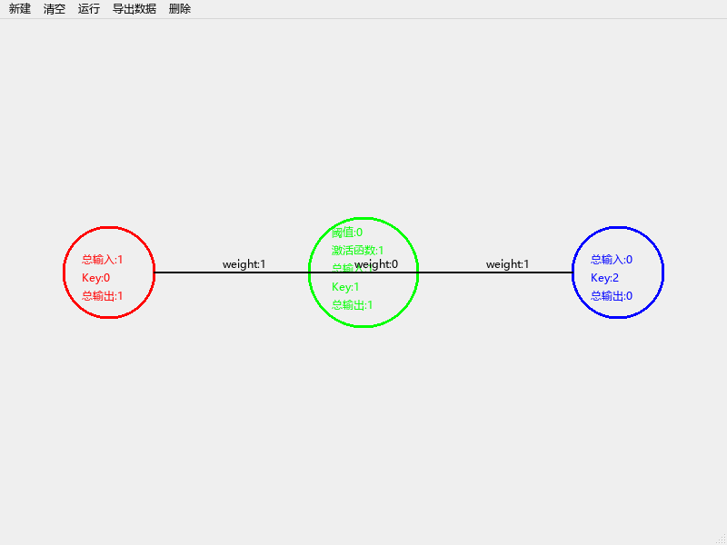 | 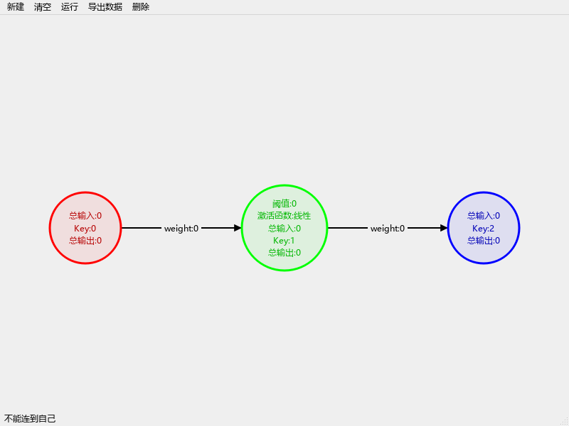 |

#### R16　阈值的用法（语义修正，会改变结果）
- **原来**（`hidden_layer.cpp:46-66`）：输出 = f(总输入) − θ。用阶跃函数时，输出是 1−θ 或 −θ，不再是 0/1；用线性函数时，阈值也不影响饱和区。
- **现在**：输出 = f(总输入 − θ)，也就是标准的 M-P（McCulloch–Pitts）神经元模型 y = f(Σ wᵢxᵢ − θ)，教材里的标准写法，比如周志华《机器学习》5.1 节。

  | 激活函数 | 总输入 | θ | 原来 f(x)−θ | 现在 f(x−θ) |
  |---|---|---|---|---|
  | 阶跃 | 0.6 | 0.5 | 0.5 | 1 |
  | 阶跃 | 0.2 | 0.5 | 0.5（和上一行一样，阈值没起到“门槛”作用） | 0 |
  | 阶跃 | −0.3 | 0.5 | −0.5 | 0 |
  | 线性（限幅 ±1） | 2.0 | 0.5 | 0.5 | 1 |
  | 线性（限幅 ±1） | 0.3 | 0.1 | 0.2 | 0.2（未饱和时两者一样） |

- **2026-11-09 已确认采用新公式。** 以后如果需要换回原来的公式，把 `network.cpp` 的 `run()` 里这一行
  `cur.output = activate(cur.activation, cur.input - cur.threshold);`
  改成 `cur.output = activate(cur.activation, cur.input) - cur.threshold;`，再改一下 `tests/tst_ann.cpp` 里 `activationFunctions` 的期望值就行。

### 2.3 交互相关

#### R5　对话框点“取消”，原来的值会被清成 0
- **原因**：`exec()` 的返回值没有判断（`mainwindow.cpp:507-514、526-538、555-562`），点取消也照样去读输入框。空字符串 `toFloat()` 得 0；两个单选框都没选时 `getflag()` 返回 0，激活函数直接失效。
- **修改**：只有 `exec() == QDialog::Accepted` 才写回。对话框打开时预填当前值并全选，激活函数默认选中“线性”。输入框加了 `QDoubleValidator`（只能输数字），并重写了 `accept()`：填的不是数字时弹提示、不关闭对话框（原来 `toFloat()` 失败也悄悄变成 0）。

  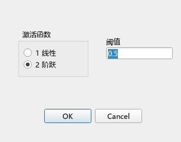　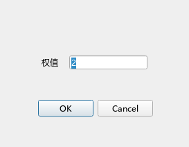

#### R8　右键从空白处拖到神经元上，也会凭空连出一条线
- **原因**：连线用的临时对象 `tmp` 是成员变量（`mainwindow.h:62`）。在空白处按下右键不会重设它的起点（`mainwindow.cpp:415-433`），松开时只要落在神经元上就建线（467-495 行），于是沿用了上一次的起点。第一次就从空白处拖的话，起点是未初始化的随机值。
- **修改**：只有在神经元上按下右键才记住起点（`m_linkFrom`），否则什么都不做；松开时只有起点有效才连线。拖动过程中画一条灰色虚线做预览。原来本想画预览线，但 `mouseMoveEvent` 里用的是 `ev->button()`（319 行），移动事件里它永远是 `NoButton`，所以预览线从来没出现过；应该用 `buttons()`。

  | 原版：多出一条 0→2 | 新版：不生成 | 新版：拖动时的虚线预览 |
  |---|---|---|
  | 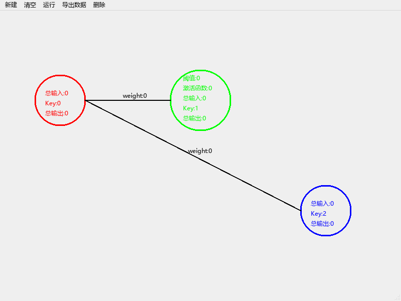 | 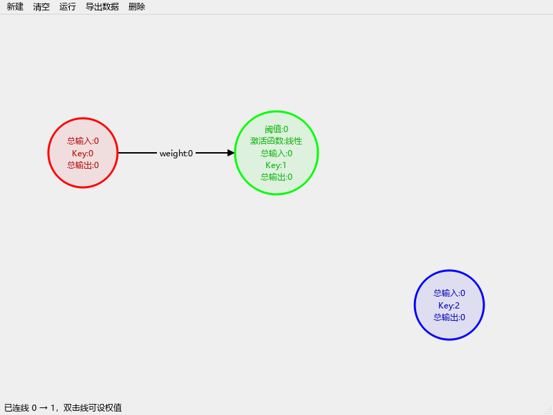 | 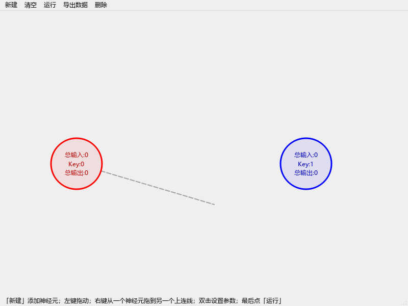 |

#### R10　从右往左连的线点不中（删不掉，也设不了权值）
- **原因**：判断“点没点中线”（`mainwindow.cpp:401-405、548-553`）时：
  - 要求 `x1 < x < x2`，从右往左的线永远不满足；
  - 竖直的线 `x1 == x2`，求斜率时除以 0；
  - 用的是“竖直方向的距离 < 3 像素”，线越陡，横向能点中的范围就越窄；
  - 线的端点固定是“起点圆的右边缘 → 终点圆的左边缘”（420、428、472、485 行），目标在左边时，线会横穿两个圆。

  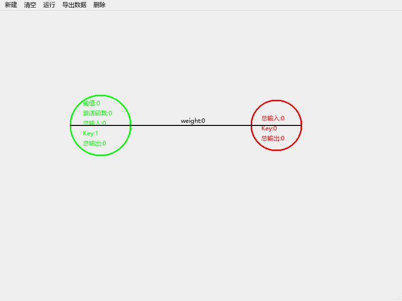

- **修改**：
  - 用**点到线段的距离**：把点投影到线段上，投影参数 t 夹在 [0, 1] 内，再求点到投影点的距离，≤ 6 像素就算点中，方向、角度都不影响。点线中间的权值标签也算点中；
  - 线的端点沿两个圆心的连线方向，从一个圆周画到另一个圆周，画的时候实时计算；末端加箭头，表示方向。

#### R11、R12　拖动：叠在一起的神经元分不开；鼠标一快就拖不动
- **原因**：
  - 按下时每一层各自找一个命中的神经元，把它标记成“正在拖”（`mainwindow.cpp:330-395`）。输入神经元和隐层神经元叠在一起时，两个都被标记，拖一个，两个一起动，从此分不开；
  - 移动时每次都重新判断“鼠标还在不在圆的外接正方形里”（262、279、300 行），鼠标一次移出 50 像素就跟丢了；
  - 松开时判断的是 `ev->buttons() == Qt::LeftButton`（438 行），可松开的那一刻左键已经不在 `buttons()` 里了，所以“正在拖”的标记永远清不掉。
- **修改**：按下时只取**最上面**的那一个神经元（倒序查找，用真正的圆形判断），记下它的 id 和“按下点相对圆心的偏移”；移动时直接移动这个神经元，不再重新判断命中，并限制在画布范围内；松开时清掉。

### 2.4 资源、健壮性、代码质量

#### R6　成员变量没初始化
- `hidden_layer` 的 `flag`、`jiflag`（`hidden_layer.h:10、13`），输入/输出神经元的 `flag`，`transport` 的 `from/to/key/坐标`（`transport.h:13-16`）都没有初值。读未初始化的变量是 UB：复现时同一个新建的隐层神经元，界面那份读到 0，图里那份读到 32763。激活函数编号不是 1 或 2 时，激活函数直接不起作用，输出一直是 0。
- **修改**：`Neuron`、`Edge` 的每个字段都写了默认初值（C++11 的“成员默认初始化”），新建隐层神经元默认是线性激活、阈值 0。

#### R7　空闲时也一直重绘，占满一个 CPU 核
- **原因**：`paintEvent` 调用的 `drawNeure()`、`drawTran()` 结尾都调了 `update()`（`mainwindow.cpp:238、254`）。`update()` 会安排下一次重绘，于是画完马上再画，永不停止。实测空闲 2 秒内重绘 3607 次，进程 CPU 时间 1969 ms，相当于一个核跑满（另一次没加载字体时，2 秒重绘了 10958 次）。
- **修改**：`paintEvent` 里不调 `update()`，只在数据或交互状态变化时才调。删除模式下的悬停高亮，也只在“指着的对象”变了时才重绘。实测空闲 2 秒：重绘 0 次，CPU 0 ms。

#### R13　每次双击都 new 一个对话框，用完不释放
- **原因**：`new Dialog3(this)` 之类（`mainwindow.cpp:507、526、555`），父对象是主窗口，所以要等主窗口关掉才释放，双击一次就多一个对象。
- **修改**：对话框建在栈上（`Dialog3 dlg(this);`），函数结束时自动销毁。这就是 RAII（Resource Acquisition Is Initialization，资源获取即初始化），对象的生命周期和作用域绑在一起。

#### 其他
- **编译警告 41 条**：都是 `-Wparentheses`，条件里把逻辑与 `&&` 写成了按位与 `&`，例如 `x>a & x<b`。比较结果是 0/1，所以碰巧算得对，但不会短路求值，可读性也差。重写后 0 警告。
- **导出路径写死**（`mainwindow.cpp:109`）：写死了本机桌面上的 `test.txt`，换一台电脑就失败，而且打开失败后还接着往里写（111-115 行）。现在弹出“另存为”对话框（默认放在“文档”目录），失败时给出提示；文件存成带 BOM（Byte Order Mark，字节顺序标记）的 UTF-8（8-bit Unicode Transformation Format），老版本记事本打开中文也不乱码。**导出的文本格式和原来完全一样**。
- **死代码**：基类 `Neure` 被私有继承，`key` 又被子类同名成员遮住，实际上没用；`outputnerue.h/.cpp` 是拼错名字的空类，没参与编译；`#define MAX 30`、`node.weight`（int 型，没用到）、`mainwindow.h` 里没用的 `Ui::Dialog *id` 等指针、头文件里的 `using namespace std;` 都去掉了。
- **新建的神经元都摞在同一个点上**：现在在本层那一列里从上往下找空位（输入 x=100、隐层 x=300、输出 x=500，和原来的位置一致）。
- **直接画在 `QMainWindow` 上**：菜单栏会盖住上面一截。现在画布是单独的中心部件（central widget）。
- **一些小改进**：抗锯齿；线末端有箭头；权值标签带底色；文字颜色比圆圈深一点（纯绿上的绿字原来很难认）；每一步操作都在状态栏给反馈；“清空”前要确认（这一步不能撤销）。

---

## 3. 结构调整：为什么不逐行打补丁

### 3.1 根本问题：同一份数据存了两份

```
修改前
MainWindow
 ├─ Ineure / Hneure / Oneure / tp      ← 界面用的一份（位置、显示的值、线的端点坐标）
 └─ Adjacency_List a
      ├─ k（结点：入度、in、out）
      ├─ tr（边）                      ← 计算用的又一份
      └─ Inputne / hidden / Outne
```

每次加点、连线、设值、删除，都要两边各改一次；运行前还要把界面上的值抄进图（`inInput / inhidden / intransport`），运行后再抄回来（`retInput / retHidden / retOutput`）。只要一处漏改、编号对不上，两边就不一致，R1、R3、R3b、R15 都是这么来的。逐行打补丁只能堵住已经发现的漏洞，结构不变，下次加功能还会再漏。

```
修改后
MainWindow ─── 菜单、对话框、导出
 ├─ Network m_net        ← 唯一的数据：neurons、edges；所有修改都走它的成员函数
 └─ NetworkCanvas        ← 只读 m_net 来画；只记“正在拖谁 / 正在从谁连线 / 当前模式”
```

### 3.2 几个具体的设计决定
- **存 id，不存下标，也不存指针**：下标在 erase 之后会变（R1 的根源），指向 vector 元素的指针在扩容后会失效。id 只增不减，永不复用。
- **三个神经元类合成一个** `Neuron` + `NeuronKind`：原来三个类九成代码相同，接口名却各不一样（`getx / getX`，`getoutput / output / Output`，`setin / setInput`），导致每个鼠标事件处理函数里都有三段几乎一样的循环。
- **线不再存端点坐标**：原来每拖一次神经元，都要去更新相关的线；现在画的时候按两端神经元的当前位置计算。
- **邻接表在 `run()` 里临时建**：长期存的是边表，画图、命中判断、删除都方便；计算时花 O(V+E) 建出邻接表和入度表，用完就丢。派生出来的数据不长期保存，就不会出现“没同步”。
- **修改只能走 `Network` 的接口**：外部拿到的是 `const` 指针，只能通过 `addEdge / removeNeuron / setWeight / setInputValue / setHiddenParams / setPosition` 修改，连线规则只在 `addEdge` 这一处检查。
- **画布和主窗口用信号槽解耦**：画布被双击时只发出 `neuronActivated(id)` / `edgeActivated(id)` 信号，弹哪个对话框由主窗口决定。所以画布可以离开对话框单独测试。

### 3.3 文件对照

| 原文件 | 新文件 | 说明 |
|---|---|---|
| `neure.*`、`inputneure.*`、`outputneure.*`、`hidden_layer.*` | `network.h`（`struct Neuron` + `NeuronKind`） | 三个类合成一个 |
| `transport.*` | `network.h`（`struct Edge`） | 不再存端点坐标 |
| `adjacency_list.*` | `network.h / network.cpp`（`class Network`） | 唯一的数据，加上增删改查和 `run()` |
| `mainwindow.cpp` 里的绘制和鼠标处理 | `networkcanvas.h / .cpp` | 画布 |
| `mainwindow.*` | 同名 | 只剩菜单、对话框、导出；`mainwindow.cpp` 从 615 行减到 193 行 |
| `dialog*.h / .cpp / .ui` | 同名 | 预填当前值、数字校验、取消不改值；`.ui` 只改了标题、单选框文字、提示、标签高度 |
| — | `numberedit.h` | 三个对话框共用的“数字输入框”逻辑 |
| `outputnerue.*` | 删除 | 拼错名字的空类 |
| — | `tests/` | 自动化测试 |
| — | `docs/` | 本记录、截图、复现程序 |

全部源码从 1732 行减到 1400 行（含新加的注释），另有测试 848 行。

---

## 4. 优化和用到的东西

| 用到的 | 用在哪 | 解决了什么 |
|---|---|---|
| **单一数据源**（single source of truth） | `Network` | 界面和计算两份数据不一致（R1、R3、R3b、R15） |
| **Kahn 拓扑排序** + 入度表 + 临时邻接表，O(V+E) | `Network::run()` | 跳层连接算错（R4）；原版大约按 V²·E 增长的耗时（§5.4） |
| **BFS 可达性判断** | `Network::reachable()`、`addEdge()` | 连线时就拒绝环路（R9） |
| **erase-remove 惯用法**（`std::remove_if` + `erase`） | `removeNeuron()` | 删除循环漏删、越界（R2） |
| **按 id 寻址，id 只增不减** | `Network` | erase 后下标错位（R1）、两套编号（R3） |
| **点到线段的距离**（向量点积投影） | `NetworkCanvas::edgeAt()` | 从右往左、竖直、很陡的线点不中（R10） |
| **交互状态机**：`Mode` 枚举 + 拖动状态 + 连线状态 | `NetworkCanvas` | 删除模式混用（R14）、拖动跟丢和粘连（R11、R12）、凭空连线（R8） |
| **只在数据变化时 `update()`** | `NetworkCanvas` | 空闲时一直重绘（R7） |
| **成员默认初始化** | `Neuron`、`Edge` | 未初始化变量（R6） |
| **栈对象 / RAII** + 判断 `exec()` 的返回值 | `MainWindow::editNeuron/editEdge` | 对话框泄漏（R13）、点取消却清零（R5） |
| **`QDoubleValidator` + 重写 `accept()`** | `numberedit.h`、三个对话框 | 填错悄悄变成 0 |
| **信号槽解耦** | 画布 → 主窗口 | 画布可以单独测试 |
| `QFileDialog` + `QStandardPaths` + 错误处理 + UTF-8 BOM | 导出 | 路径写死、失败后照样写 |
| `QPainter` 抗锯齿、箭头、标签底色 | 绘制 | 看清方向、读清数字 |
| **Qt Test**：数据驱动用例、`QSignalSpy`、合成鼠标事件、offscreen 平台 | `tests/` | 每条 bug 都有回归测试，能在命令行里自动跑 |

---

## 5. 验证

### 5.1 复现程序：先确认原版的问题都是真的

`docs/repro/repro_original.cpp` 直接链接原版源码（一行不改）：用 `QMouseEvent` 模拟鼠标，用定时器自动填写、关闭对话框，跑完检查内部数据。为了读私有成员，用了 `#define private public`，这是只在测试代码里用的手段。结果 **17/17 条复现**，完整输出在 `docs/repro/repro_report.txt`。

### 5.2 自动化测试：41 个用例全部通过

`tests/tst_ann.cpp`（Qt Test），分三组：

| 组 | 用例 | 对应 |
|---|---|---|
| 模型 `NetworkTest`（25 个） | `idsAreUniqueAndNeverReused` | R3、R3b |
| | `removeNeuronRemovesExactlyItsEdges` | R1、R2 |
| | `weightWorksAfterDeletingAnEdge` | R3 |
| | `clearThenRebuildGivesSameResult` | R3b |
| | `skipConnectionComputedCorrectly`、`runTwiceDoesNotAccumulate` | R4 |
| | `runResetsStaleResults` | R15 |
| | `connectRules`（8 组数据：自环、重复、从输出出发、连向输入、成环、不存在、两种合法连线） | R9 |
| | `activationFunctions`（6 组数据） | R16 |
| | `hiddenDefaultsAreDefined` | R6 |
| | `randomDagOrderAndSums`：随机分层 DAG（含跳层），检查顺序是合法拓扑序，且每个神经元的总输入 = 上游输出 × 权值之和 | R4 |
| | `reportTextFormat` | 导出格式与原来一致 |
| | `runIsFast` | 性能 |
| 画布 `CanvasTest`（10 个，放在真正的主窗口里，用模拟鼠标操作） | `fastDragFollowsMouse` | R12 |
| | `overlappingDragMovesOnlyTop` | R11 |
| | `rightDragFromEmptySpaceMakesNoEdge` | R8 |
| | `rightDragShowsPreviewAndCreatesEdge` | R8（预览线） |
| | `selfLoopRejectedInUi` | R9 |
| | `deleteNeuronByClick` | R1 |
| | `deleteRightToLeftAndVerticalEdges` | R10 |
| | `deleteModesAreSeparateAndCancellable` | R14 |
| | `doubleClickEmitsSignals` | 双击 |
| | `noRepaintWhenIdle` | R7 |
| 主窗口 `MainWindowTest`（6 个） | `cancelKeepsValuesAndDialogsArePrefilled` | R5 |
| | `okWritesValues`、`invalidNumberKeepsDialogOpen` | 对话框 |
| | `dialogsAreFreed` | R13 |
| | `exportWritesUtf8File` | 导出 |
| | `endToEndSkipConnectionViaUi`：新建 → 拖动 → 右键连线 → 双击设参数 → 运行，全部走界面 | R4 |

### 5.3 前后对比截图
见 §2 各条。截图是测试和复现程序在 offscreen 平台（Qt 不弹窗口、只在内存里渲染）下用 `grab()` 截的，字体指定为微软雅黑 UI 9pt，和 Windows 上实际运行时接近。

### 5.4 性能

同一个分层全连接网络（没有跳层连接，原版在这种网络上结果是对的，两边算出来的输出完全一样），跑一次前向计算的耗时。原版编译时关掉了 `qDebug`，只比算法本身：

| 网络 | 神经元 | 边 | 原版 `TopSort` | 新版 `run()` |
|---|---|---|---|---|
| 4-4-2 | 10 | 24 | 2.35 ms | 0.005 ms |
| 10-10-4 | 24 | 140 | 30 ms | 0.016 ms |
| 30-30-10 | 70 | 1200 | 2231 ms | 0.077 ms |
| 60-60-20 | 140 | 4800 | 36671 ms | 0.25 ms |

- **说句公道话**：平时手搭十几个神经元，原版也就几毫秒，感觉不到慢。对日常使用来说，这次修改的价值在于**结果对了**，而不是速度。速度差距要到几十个神经元以上才看得出来。
- 原版的耗时大约按 V²·E 增长：从 30-30-10 到 60-60-20，V 翻倍、E 翻四倍，耗时变成约 16 倍。原因是同一个节点会被重复入队约 V² 次，每次出队都要把所有边扫一遍。
- 新版 `run()` 的耗时和 V+E 成正比。每次跑的数字会有波动（同一个测试两次分别是 0.10 ms 和 0.24 ms），量级不会变。
- 连线时的环检测是一次 BFS，O(V+E)，每次连线只做一次，交互时可以忽略。

### 5.5 没有验证到的
- 测试里的鼠标是合成事件，在 offscreen 平台下运行，**我没有在你的桌面上真的用鼠标点过**，建议你在 Qt Creator 里实际点一遍。
- 只在 Qt 6.1.3 MinGW 64-bit 上编译过。代码用了 Qt 6 的接口（`QMouseEvent::position()`、`QStringConverter`），Qt 5 编译不了，`.pro` 里加了版本检查。

---

## 6. 怎么编译、运行、测试

### Qt Creator
1. 打开 `E:\Claude code\ann-qt\ANN.pro`，第一次打开会让你选 Kit，选 **Desktop Qt 6.1.3 MinGW 64-bit**；
2. 运行：Ctrl+R；
3. 跑测试：再打开 `tests\tst_ann.pro` 运行，结果显示在“应用程序输出”面板，最后几行 `Totals: … 0 failed` 就是全部通过。

### 命令行（PowerShell，在 `E:\Claude code\ann-qt` 目录下）

```powershell
$env:PATH = "D:\Qt\6.1.3\mingw81_64\bin;D:\Qt\Tools\mingw810_64\bin;" + $env:PATH
```
- 只对当前这个 PowerShell 窗口生效：把 Qt 的工具（`qmake`、运行时 DLL）和 MinGW 编译器放到 PATH 最前面，关掉窗口就失效，不改系统设置。

```powershell
qmake -o build\Makefile ANN.pro -spec win32-g++ "CONFIG+=release"
```
- `qmake`：读 `.pro` 文件，生成 Makefile；
- `-o build\Makefile`：Makefile 写到 `build` 目录，编译产物不和源码混在一起（影子构建）；
- `-spec win32-g++`：目标是 Windows + g++（MinGW）；
- `"CONFIG+=release"`：只编 release 版。

```powershell
mingw32-make -C build -j8
```
- `mingw32-make`：MinGW 版的 make，按 Makefile 编译、链接；
- `-C build`：先进到 `build` 目录再执行；
- `-j8`：最多 8 个编译任务同时进行。
- 注意：**不要在 Git Bash 里执行这一步**。Git Bash 的 `sh.exe` 在 PATH 里时，make 会用它来执行命令，而 qmake 生成的 Makefile 写的是 cmd 语法。请用 PowerShell 或 cmd。

```powershell
.\build\release\ANN.exe
```
- 能直接运行，是因为上面已经把 Qt 的 DLL 目录加进了 PATH。想双击运行，或者拷到别的电脑上，先执行 `windeployqt build\release\ANN.exe`：它会把程序依赖的 Qt DLL 和平台插件拷到 exe 旁边。

**跑测试：**
```powershell
qmake -o tests\build\Makefile tests\tst_ann.pro -spec win32-g++ "CONFIG+=release"
mingw32-make -C tests\build -j8
$env:QT_QPA_PLATFORM = "offscreen"
$env:QT_QPA_FONTDIR = "C:\Windows\Fonts"
.\tests\build\release\tst_ann.exe
```
- 前两行和上面一样，只是换成测试工程；
- `QT_QPA_PLATFORM=offscreen`：QPA（Qt Platform Abstraction，Qt 平台抽象层）选 offscreen，窗口只在内存里画，不弹出来；不设也能跑，只是会闪过几个窗口；
- `QT_QPA_FONTDIR`：offscreen 平台不会自己去找系统字体，不设的话截图里没有字（测试结果不受影响）；
- 可选 `$env:ANN_SHOTS = "某个目录"`：顺便把“修改后”的截图存到那里；
- 如果是在没有控制台的环境里运行（比如被别的程序调用、输出被重定向），Qt Test 会把结果写到调试输出而不是屏幕，加 `$env:QT_FORCE_STDERR_LOGGING = "1"` 就能打印出来。这次我在工具环境里就遇到了这种情况。

**重跑原版复现程序（可选）：**
```powershell
git archive -o docs/repro/orig.tar 4ffc9e2
mkdir docs/repro/orig
tar -xf docs/repro/orig.tar -C docs/repro/orig
qmake -o docs\repro\build\Makefile docs\repro\repro_original.pro -spec win32-g++ "CONFIG+=release"
mingw32-make -C docs\repro\build -j8
.\docs\repro\build\release\repro_original.exe docs\repro\out
```
- `git archive -o docs/repro/orig.tar 4ffc9e2`：把 `4ffc9e2` 这个提交里的全部文件（也就是原版）打包成一个 tar 文件，不影响当前的工作区；
- `tar -xf … -C docs/repro/orig`：`-x` 解包，`-f` 指定包文件，`-C` 解到哪个目录。Windows 10 自带 `tar`。这里分成两步，而不是用管道 `git archive 4ffc9e2 | tar -x`，是因为 PowerShell 5.1 的管道会把二进制数据当文本处理，包会坏掉；
- 最后一行的参数是输出目录，`repro_report.txt` 和截图会写到那里。`docs/repro/orig/` 和 `orig.tar` 已经写进 `.gitignore`。

---

## 7. 新版怎么操作

| 想做什么 | 怎么做 |
|---|---|
| 加神经元 | 菜单“新建” → 输入 / 隐层 / 输出神经元（自动排在各自那一列的空位上） |
| 移动 | 左键按住拖动 |
| 连线 | 右键在起点神经元上按下，拖到终点神经元上松开（拖动时有虚线预览）。不合法的连线会被拒绝，状态栏说明原因 |
| 设置初值 / 阈值和激活函数 / 权值 | 双击输入神经元 / 隐层神经元 / 线（或线上的权值标签）。对话框里是当前值，点“取消”不做任何修改 |
| 删除 | 菜单“删除” → 删除点 / 删除线，再点要删的对象（会高亮）。删一个后自动退出；Esc 或右键取消 |
| 计算 | 菜单“运行”，状态栏显示计算顺序（拓扑序） |
| 导出 | 菜单“导出数据” → 输出 txt，选择保存位置 |
| 清空 | 菜单“清空”，会先确认 |

---

## 8. 没做的、可以接着做的

- **网络不能保存和读取**（原版也没有）：可以用 `QJsonDocument` 存成 JSON。
- **没有撤销 / 重做**：可以用 `QUndoStack`。
- **不能训练，只能做前向计算**：要做 BP（Back Propagation，反向传播）算是新功能，不属于修 bug。
- **画布不能滚动、缩放**：网络大了会放不下。
- **git**：所有改动都在 `E:\Claude code\ann-qt` 的工作区里，**没有提交**，HEAD 还是 2021 年的原版，`git diff` 能看到全部改动。`ANN.pro.user`（Qt Creator 的本机配置，里面写死了旧的构建目录）从副本里删掉了，`git status` 里会显示为删除；`.gitignore` 里补上了它和构建目录。
- 原来的 `Documents\ANN` 没动，包括那个被覆盖了的 `dialog.ui`。
